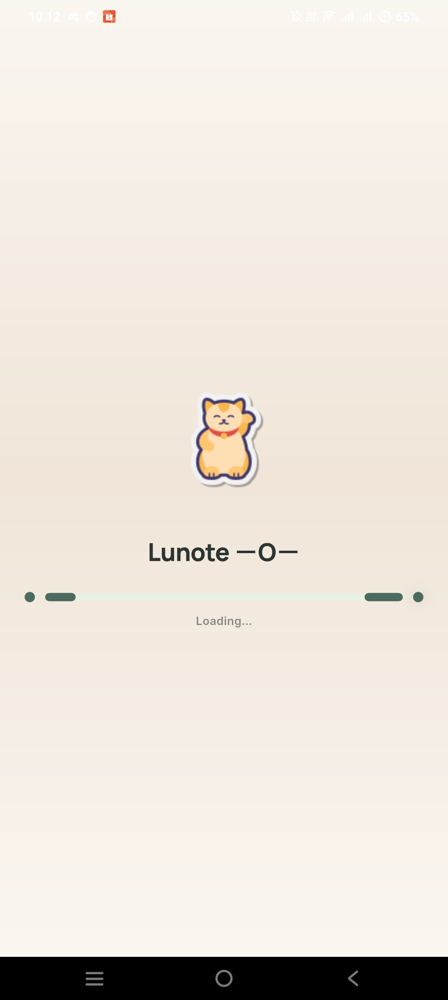
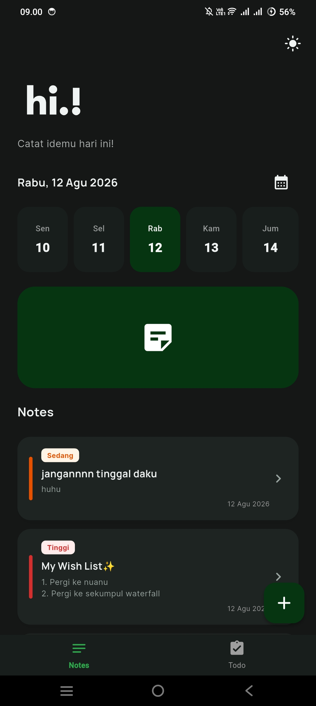
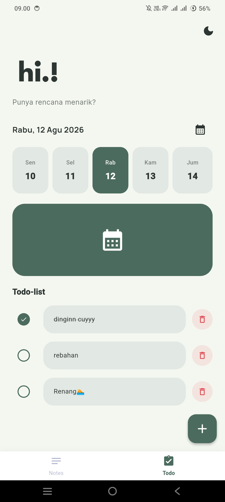

<div align="center">

# 🌙 Lunote

### Simple To-Do List & Notes App

Lunote adalah aplikasi sederhana yang menggabungkan fitur  
**To-Do List** dan **Notes** dalam satu tempat.

Dirancang dengan tampilan minimalis untuk membantu pengguna  
mencatat ide, mengatur tugas, dan meningkatkan produktivitas sehari-hari ✨
       


</div >
 <div align="center">
| | 
|
 </div>
---


## ✨ Features

- 📝 Create and manage notes
- ✅ Add daily task lists
- 📌 Mark tasks as completed
- 🎨 Minimalist and modern UI
- 📱 Simple and user-friendly interface

---

## 🛠️ Technologies Used

| Technology | Description |
|---|---|
| Flutter | UI Framework |
| Dart | Programming Language |
| Material Design | UI Design System |

---

## 🚀 Installation

( Step 1 ) --------> ( Step 2 ) --------> ( Step 3 ) --------> ( Step 4 )
 Git Clone             cd lunote            flutter pub get       flutter run

 ## 💖 Contributing & Support
 ```text
     .-.   .-.
    (   `-'   )          "Every small contribution makes
     `-.   .-'            Lunote even more magical!"
        `-'
       /   \             Saran, perbaikan bug, atau ide baru
      /     \            selalu diterima dengan hangat! 🌸✨
     '-------'
```
